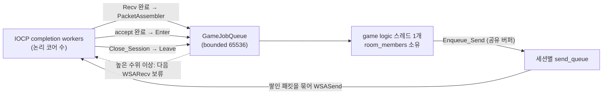

# v7 — IOCP + game logic queue

> 현재 상태: 완료

## 목표

v6의 IOCP completion I/O 위에 **패킷 조립 → game job 큐 → 단일 game logic 스레드** 단계를 얹어,
네트워크 완료 처리와 게임 로직을 서로 다른 스레드로 분리한다. 게임 로직은 간단한 채팅방
(입장/퇴장 알림, 채팅 브로드캐스트)으로 구현했다.

## 구성 파일

- [include/packet.h](include/packet.h), [src/packet.cpp](src/packet.cpp): 패킷 형식과 직렬화
- [include/packet_assembler.h](include/packet_assembler.h), [src/packet_assembler.cpp](src/packet_assembler.cpp): TCP 스트림 → 패킷 조립
- [include/game_job_queue.h](include/game_job_queue.h), [src/game_job_queue.cpp](src/game_job_queue.cpp): bounded job 큐
- [include/async_logger.h](include/async_logger.h), [src/async_logger.cpp](src/async_logger.cpp): 전용 스레드가 출력하는 비동기 로거
- [include/iocp_game_server.h](include/iocp_game_server.h), [src/iocp_game_server.cpp](src/iocp_game_server.cpp): IOCP 서버와 game logic
- `tests/v7_unit_tests.cpp`(지금은 저장소에 없음): 조립기·큐·로거 단위 테스트 (`ctest`)
- `tests/v7_smoke_test.py`(지금은 저장소에 없음): 실제 서버를 띄워 확인하는 통합 테스트(지연시간 p50/p95/p99 포함)
- [../../.github/workflows/v7-windows.yml](../../.github/workflows/v7-windows.yml): Release·ASan 빌드를 확인하는 CI(테스트를 지운 뒤로는 빌드만)
- 위 `tests/`·`tools/`의 테스트와 부하 봇은 커밋하기 전에 저장소에서 지웠다. 검증 결과는 그때 실행한 기록이며,
  아래 `실행과 테스트`의 테스트 명령은 지금은 그대로 동작하지 않는다. CI는 서버 빌드(Release·ASan)만 확인한다.

## 패킷 형식

```
[uint16 size][uint16 id][body ...]   (little-endian, size는 헤더 4바이트 포함, 최대 8 KiB)
```

| id | 방향 | body |
|---|---|---|
| 1 `C_Chat` | client → server | UTF-8 텍스트 |
| 101 `S_Welcome` | server → client | uint32 session_id |
| 102 `S_Chat` | server → 방 전체 | uint32 발신 session_id + UTF-8 텍스트 |
| 103 `S_Notice` | server → 방 전체 | UTF-8 입장/퇴장 알림 |

size가 헤더보다 작거나 최대 크기를 넘으면 스트림 경계를 더 신뢰할 수 없으므로 연결을 끊는다.
알 수 없는 id도 연결을 끊는다.

## 스레드와 데이터 흐름



- **조립기에는 락이 없다.** 세션마다 `WSARecv`를 하나만 pending으로 두기 때문에 같은 세션의
  Recv completion은 동시에 처리되지 않는다.
- **game logic 스레드는 1개다.** 방 상태(`room_members`)를 이 스레드만 다루므로 mutex가 필요 없고,
  세션별 패킷 처리 순서도 큐 순서 그대로 보장된다. 로직이 무거워지면 이 스레드가 병목이 되는 것이
  트레이드오프다.
- **Enter는 첫 `Post_Recv` 전에 큐에 넣는다.** 그래서 한 세션의 Packet job이 Enter보다 먼저 처리될 수 없다.
  Leave는 `closing`을 세운 뒤 넣고, `Handle_Enter`가 `closing`을 확인해 닫힌 세션이 방에 남지 않게 한다.
- **브로드캐스트 버퍼는 공유한다.** `send_queue`의 원소를 `shared_ptr<const vector<char>>`로 바꿔 방
  인원수만큼 복사하지 않는다. 실제 `WSASend`에는 v6처럼 context 자체 버퍼로 복사해 pending I/O 수명을 지킨다.
- **쌓인 패킷은 묶어서 보낸다.** 세션당 `WSASend`는 하나만 진행한다. 송신 중인 세션에는 logic 스레드가 큐에
  넣기만 하고, Send completion 때 그동안 쌓인 여러 패킷을 64 KiB 버퍼에 이어 붙여 한 번에 보낸다. 같은
  부하에서 처리량이 약 3배가 됐다. 송신 게시를 IOCP worker로 넘기는 방식도 비교했지만 오히려 느려져 채택하지
  않았다(`basicdata/troubleshooting.md` 참고).
- **세션 context는 재사용한다.** 세션당 Recv와 Send는 각각 하나만 pending이므로 세션이 context를 하나씩
  소유하고 다시 게시한다. pending 동안 context가 세션을 `shared_ptr`로 붙잡고, completion 처리 시작 시 놓는다.
- **생산자는 기다리지 않고, 과부하는 Recv를 멈춰 전달한다.** job 큐가 높은 수위(기본 8,192) 이상이면 해당
  세션의 다음 `WSARecv`를 보류해 TCP 흐름 제어로 클라이언트 송신을 늦춘다. 낮은 수위(기본 1,024) 이하로
  내려가면 다시 게시한다. 최종 상한(65,536)에 닿을 때만 연결을 끊는다. 수위는
  `V7_JOB_HIGH_WATERMARK`/`V7_JOB_LOW_WATERMARK`로 바꿀 수 있다.
- **느린 클라이언트 보호.** 세션 송신 큐에 아직 보내지 않은 데이터가 4 MiB를 넘으면 응답을 읽지 않는
  클라이언트로 보고 끊는다.
- **로그는 전용 스레드가 출력한다.** stdout이 막혀도 IOCP worker와 logic 스레드는 멈추지 않는다. 로그
  큐가 넘치면 버리고 개수를 `[Status]`의 `log_dropped`에 남긴다.

## 종료 순서

1. `Stop()`: `Running → Stopping` 전환과 `run_cv` 알림만 수행한다.
2. job 큐 `Close()` → game logic 스레드 join. 남은 job은 처리하지 않고 버린다(`jobs discarded`).
   logic 스레드가 살아 있으면 정리 도중에도 송신을 계속 요청하기 때문에 가장 먼저 멈춘다.
3. 모든 세션 socket과 pending accept socket을 닫아 overlapped I/O를 취소한다.
4. pending context가 모두 회수될 때까지 기다린다(5초마다 남은 수 진단).
5. null completion으로 IOCP worker를 깨워 join하고 IOCP/listen socket/Winsock을 정리한다.

`Server_Run` 스레드는 Stop을 기다리는 동안 10초마다 `[Status]` 로그로 세션 수, pending I/O,
job 큐 길이와 최고치, Recv 일시정지 횟수, `WSASend` 게시 수, 처리량을 출력한다.

## 실행과 테스트

```powershell
cmake -S server -B build/server -A x64
cmake --build build/server --config Release --target v7_server v7_unit_tests
ctest --test-dir build/server -C Release --output-on-failure
python server/v7/tests/v7_smoke_test.py <절대경로>/build/server/v7/Release/v7_server.exe --clients 200 --messages 10
```

로그 양은 `V7_LOG_LEVEL=debug|info|error`로 조절한다. GUI(`MMO Server Lab`)에서 v7을 선택하면
클라이언트가 패킷 프로토콜로 동작하고, 공통 채팅에는 각 방송을 발신자 기준으로 한 번씩 표시한다.

## 검증 결과 (2026-11-19, native Windows, MSVC C++20, Release)

- 단위 테스트: 다중 패킷, 1바이트 분할, 빈 본문, 비정상 size, 큐 순서·용량·Close 후 drain,
  로거의 다중 스레드 줄 무결성과 상한 초과 시 버림 통과
- 50 clients × 20 msg: 채팅 1,000개 → 50,000건 전달, 발신자별 순서 유지, 95,887~120,172 전달/초,
  자기 채팅 왕복 p50 209~285ms, p99 409~511ms(채팅을 한꺼번에 보내는 부하, 측정 5회)
- 200 clients × 10 msg: 채팅 2,000개 → 400,000건 전달, 발신자별 순서 유지, 50,776~55,319 전달/초
- 1바이트씩 나눠 보낸 패킷 정상 방송, size=2 헤더 수신 시 연결 종료
- 수위 64/16의 backpressure 시나리오: Recv 일시정지 4회, 거부된 job 0개, 80,000/80,000 전달
- 응답을 읽지 않는 클라이언트에 1 KB 채팅 12,000개를 방송: 송신 큐 바이트 상한으로 해당 세션만 종료,
  이후 서버 종료 코드 0과 pending I/O drain 확인
- MSVC AddressSanitizer(RelWithDebInfo) 빌드로 위 전체 시나리오 통과, 오류 보고 없음
- GUI에서 v7 방 시작, 3개 클라이언트 채팅, 방 종료(서버 종료 코드 0)를 UI Automation으로 확인
- 개선 전후 비교와 측정 조건은 [basicdata/benchmark.md](../../basicdata/benchmark.md) 참고. 부하 클라이언트가
  같은 머신의 Python 단일 프로세스라 200 clients 구간은 클라이언트 쪽이 상한일 수 있다.
- v5와 같은 조건 비교(클라이언트 1명): 주고받기 p50 112~133µs(v5 198~237µs, OS 기준선 차이 포함),
  연속 전송 90,556~104,514 메시지/초(v5 120,471~125,300), 유휴 연결 1,000개 메모리 133.2 MB(v5 3.6 MB).
  자세한 조건과 해석은 benchmark.md 참고.
